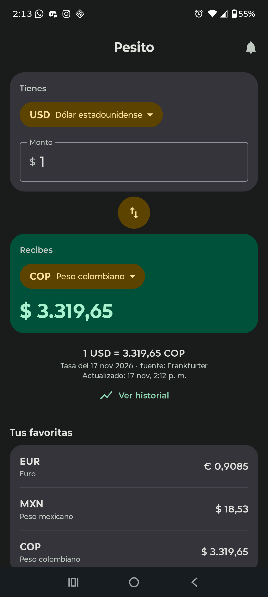
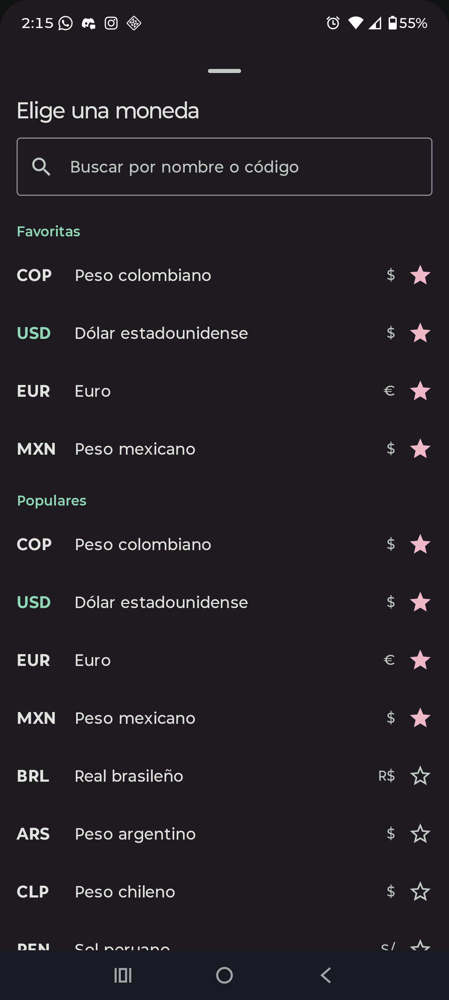
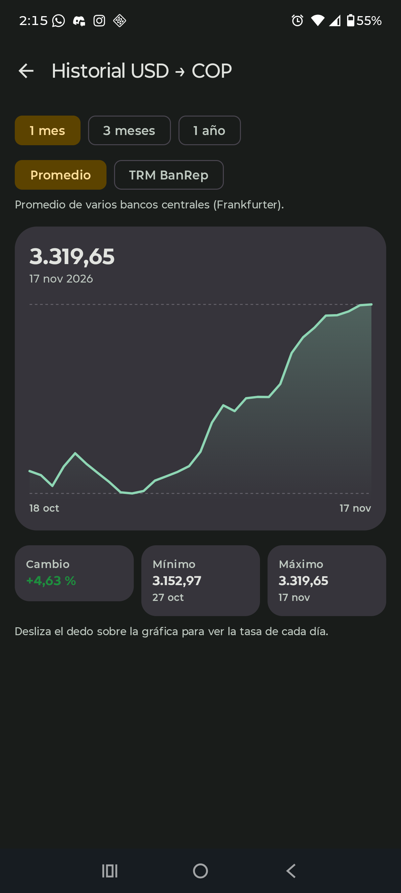
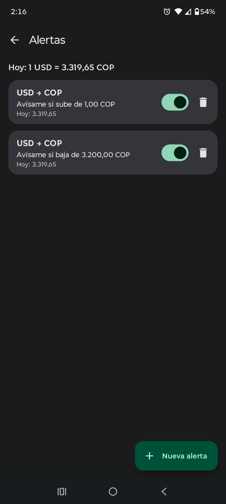
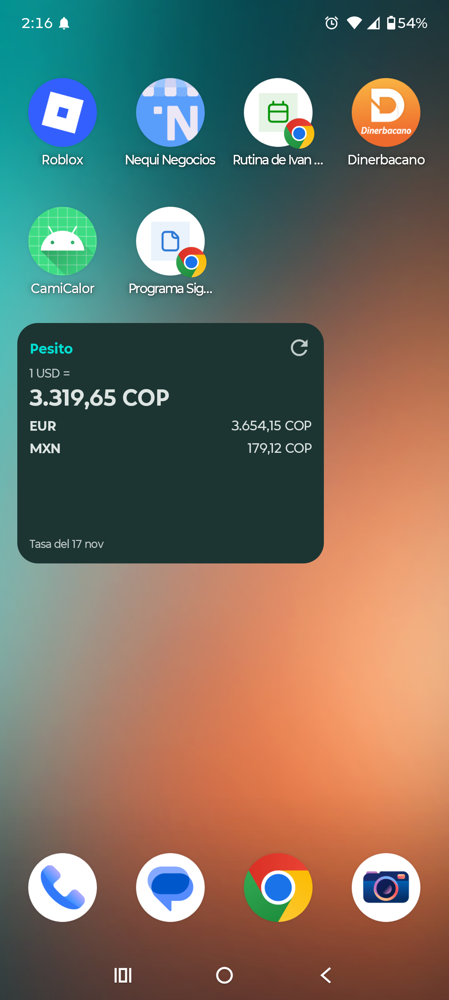
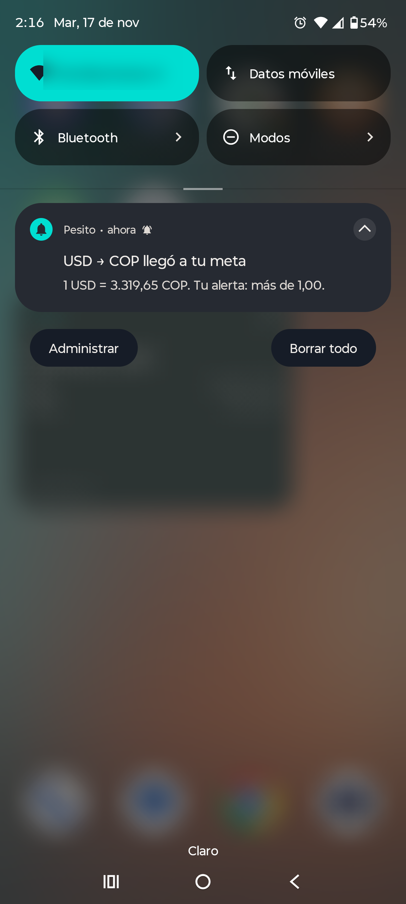
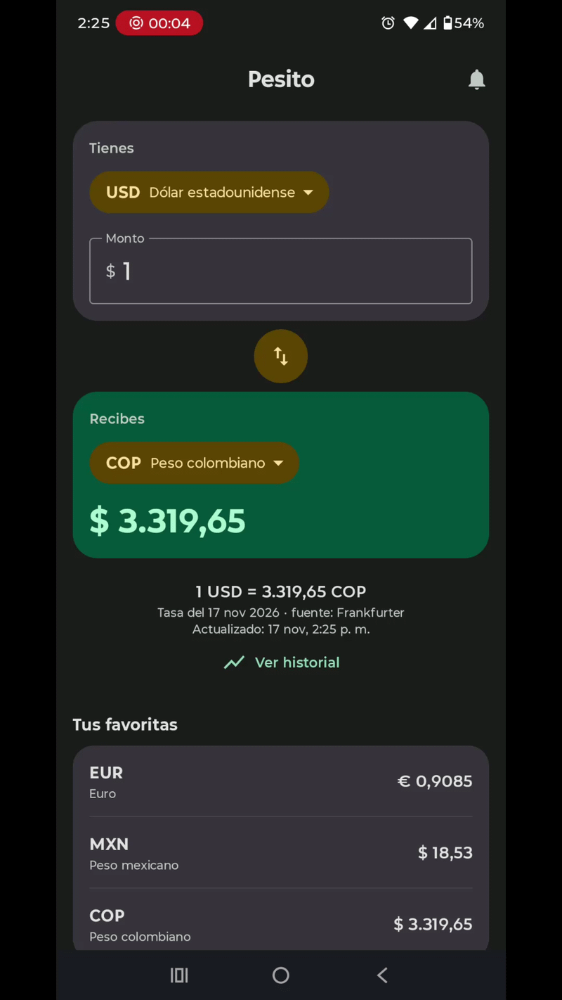
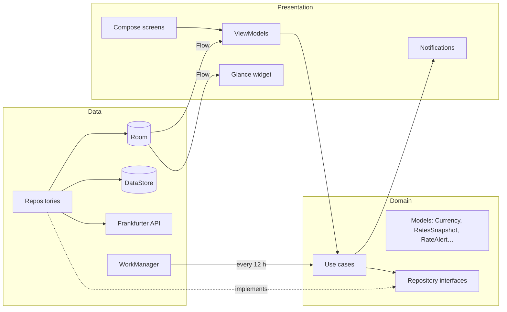

<p align="center">
  
</p>

<h1 align="center">Pesito</h1>

<p align="center">
  A currency converter for Android built around the <b>Colombian peso</b>.<br/>
  Works offline, lives on your home screen and tells you when the dollar hits your number.
</p>

<p align="center">
  <a href="https://github.com/IvanArroyo28/Pesito-android/actions/workflows/android-ci.yml"></a>
  
  
  
</p>

<p align="center">
  <a href="https://github.com/IvanArroyo28/Pesito-android/releases/latest"><b>⬇️ Download the APK</b></a>
</p>

---

## 📱 Screenshots

<p align="center">
  
  
  
</p>
<p align="center">
  
  
  
</p>

<p align="center">
  
</p>

## ✨ Features

- **Converter**: convert between dozens of currencies with exact decimal math (`BigDecimal`, never `Double`) and Colombian number formatting (`3.293,28`).
- **Offline-first**: rates are stored on the device, so the app keeps working without internet and shows when the data was last updated.
- **Favorites**: star your currencies and see the same amount converted to all of them at once. The app also reopens on the last pair you used.
- **Rate history**: a line chart drawn by hand with Compose `Canvas`, covering 1 month, 3 months or 1 year. Drag your finger to see each day's rate.
- **Official TRM**: switch between the average market rate and the official rate published by the **Banco de la República** (USD ↔ COP only).
- **Background sync**: WorkManager refreshes the rates every 12 hours, only when there is a connection, with exponential backoff.
- **Home screen widget** (Glance): your last pair and favorites at a glance, with a refresh button.
- **Rate alerts**: "notify me when 1 USD drops below 3,200 COP". You get a notification when it happens, including the Android 13+ runtime permission flow.

## 🛠 Tech stack

| Area | Tools |
|---|---|
| UI | Jetpack Compose, Material 3, Navigation Compose (type-safe routes), Compose Canvas |
| Architecture | Clean Architecture (domain / data / presentation), MVVM, unidirectional data flow |
| Async | Kotlin Coroutines, Flow (`combine`, `stateIn`, `transformLatest`) |
| DI | Hilt (including `@HiltWorker` and an `@EntryPoint` for the widget) |
| Network | Retrofit 3, kotlinx.serialization, custom `BigDecimal` serializer |
| Local data | Room (with a real migration), DataStore Preferences |
| Background | WorkManager (periodic + one-time work) |
| Widget | Jetpack Glance |
| Testing | JUnit 4, kotlinx-coroutines-test, hand-written fakes |
| CI | GitHub Actions: unit tests and debug build on every push |

## 🏗 Architecture



**The device database is the single source of truth.** Screens and the widget only *observe* Room and DataStore. The network is only used to fill Room. So when WorkManager downloads new rates in the background, the converter, the favorites list and the widget all update themselves, and nothing breaks when there is no internet.

```
app/src/main/java/com/ivanarroyo/pesito
├── domain          # Pure Kotlin: models, repository interfaces, use cases (no Android)
├── data
│   ├── remote      # Retrofit API, DTOs, BigDecimal serializer
│   ├── local       # Room entities, DAOs, migrations
│   ├── preferences # DataStore (favorites, last pair)
│   ├── mapper      # DTO ⇄ entity ⇄ domain
│   ├── repository  # Repository implementations
│   └── sync        # WorkManager worker + scheduler
├── di              # Hilt modules
└── presentation
    ├── converter   # Main screen + currency picker
    ├── history     # Chart screen (Canvas)
    ├── alerts      # Alerts screen + permission flow
    ├── widget      # Glance widget
    ├── notifications
    ├── navigation
    └── util        # Amount input rules, Colombian formatting
```

## 💡 Decisions worth mentioning

- **Money is never a `Double`.** Rates are parsed straight from the JSON text into `BigDecimal` and stored as `TEXT` in Room, because SQLite `REAL` would silently round them.
- **One download, any pair.** All rates are stored against USD, and any pair is computed as a cross rate (`EUR → COP = rate(COP) / rate(EUR)`).
- **Testable time.** Use cases receive a `java.time.Clock` instead of calling `LocalDate.now()`, so tests can fix "today".
- **The widget is never told to update.** A small observer redraws it whenever Room or DataStore change, even when the change comes from a background worker.
- **Alerts fire once.** A triggered alert switches itself off, so you don't get the same notification every 12 hours.
- **Database migrations get serious when user data appears.** The first versions only cached the API and could be wiped. Since alerts were added, schema changes use a real `Migration`.

## 🧪 Tests

70+ unit tests cover the conversion math, mappers, JSON precision, repositories (including "no internet keeps the saved rates"), use cases, the sync policy, the widget state and the converter `ViewModel`.

```bash
./gradlew testDebugUnitTest
```

## 🚀 Build it yourself

1. Clone the repo and open it in a recent Android Studio. The project uses AGP 9 and JDK 21.
2. Run the `app` configuration on a device or emulator with Android 8.0 or newer.

No API key is needed.

## 🙏 Data

Exchange rates come from the free, open-source [Frankfurter API](https://frankfurter.dev). The official Colombian rate (TRM) is published by the [Banco de la República](https://www.banrep.gov.co).

## 👤 Author

**Ivan Arroyo**, Systems Engineering student from Cartagena, Colombia 🇨🇴
[GitHub](https://github.com/IvanArroyo28)
